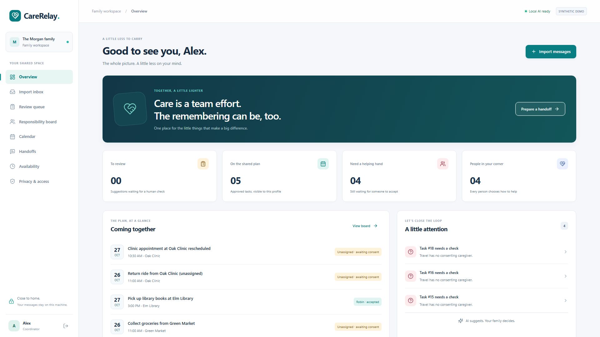

# CareRelay

**A little less to carry.** A local-first family coordination assistant that turns scattered messages into an evidence-linked, human-approved plan.

CareRelay is a functional prototype for **fictional care circles on a trusted local machine**. It is organizational software, with no diagnosis, dosing or treatment guidance. Demo inputs are explicitly labeled synthetic. It never sends messages externally.



[Watch the narrated demo](https://youtu.be/ylEdw_ICXTU) · [Read the published implementation and evaluation story](https://dev.to/faris-khan/everyone-wanted-to-help-nobody-had-the-whole-plan-2pjk)

## Run locally

Requirements: Python 3.12+, Node 22+, and Ollama. The default model is **Ministral 3 14B**, chosen by the user instead of the original Qwen default. Its Ollama download is approximately 9.1 GB; runtime needs additional memory. The inspected development machine has an RTX 4090 with 24 GB VRAM. Upstream model license: [Apache 2.0](https://ollama.com/library/ministral-3).

```powershell
ollama pull ministral-3:14b
python -m venv .venv
.\.venv\Scripts\Activate.ps1
pip install -r backend/requirements.txt
Copy-Item .env.example .env
npm install
python scripts/install_temporal.py
```

Run these in separate terminals from this directory:

```powershell
.\.tools\temporal\temporal.exe server start-dev --ip 127.0.0.1 --port 7233 --ui-port 8233 --db-filename data/temporal.sqlite --ui-disable-news-fetch
```

```powershell
python -m backend.temporal_worker
```

```powershell
python -m uvicorn backend.main:app --host 127.0.0.1 --port 8104
```

```powershell
npm run dev
```

Open **http://127.0.0.1:3104**. Ollama should already be running on `127.0.0.1:11434` (otherwise run `ollama serve`). Create a fictional care circle and use **Import inbox → Load fictional conversation**. The model indicator must show ready before importing.

An **untested optional Docker Compose configuration** is included (`docker compose up --build`). It explicitly uses the original inline import engine and Docker Desktop's `host.docker.internal` for Ollama. The frontend and backend share a network namespace so the API proxy remains loopback-local. The manual Temporal setup above is the verified durable path; see [Temporal setup and recovery evidence](docs/TEMPORAL.md). On non-Windows systems, install the CLI using [Temporal's official instructions](https://docs.temporal.io/cli/setup-cli) instead of the Windows installer.

The browser talks through Next.js to FastAPI; its rewrite defaults to port 8104. Set `BACKEND_URL` when using a different backend address. All displayed planning times use PKT (UTC+05:00); imported timestamps must include a timezone. For production compilation use `npm run build` and `npm start`.

## What works

- Four synthetic caregiver profiles and seeded unavailability windows.
- Paste/upload plain text, label synthetic inputs, select private or circle visibility, and set the source reference time.
- Genuine local Ollama extraction with a typed JSON schema. Exact quotes and source IDs are validated before any suggestion is saved. A failed quote rejects the whole extraction result.
- Durable Temporal import workflows, a persistent local service, a separate extraction worker, automatic transient retries and recovery after API/worker restarts. A transactional SQLite outbox and attempt-checked commits prevent duplicate workflow starts and duplicate suggestions. Queued imports reconnect after a browser refresh.
- Edit/approve/reject queue, with explicit date and uncertainty acknowledgement.
- Approved responsibility board and calendar; caregivers accept their own proposed assignments. A proposed name alone never means consent.
- Unassigned travel, overlapping assignments and unavailability warnings. Task duration is a documented one-hour scheduling estimate.
- Human-approved cancellation/rescheduling that cancels the prior task and resets consent for the replacement. Related transport is **not** silently moved; it remains a separate human decision.
- Evidence-linked day briefs with accepted and unresolved sections. Model reference validation is followed by deterministic rendering from approved records to prevent invented prose and omitted tasks. Private evidence is excluded.
- Handoff approval and copying revalidate task versions. A changed plan requires a fresh draft. No external sending integration.
- Server-side permissions, token hashing, profile/circle visibility checks and an audit trail.

## Verification

```powershell
python -m pytest tests -q -p no:cacheprovider
npm run typecheck
python scripts/model_smoke.py
python scripts/api_smoke.py
python scripts/evaluate.py
npx playwright install chromium
npm run test:e2e
```

Start both servers and Ollama before browser tests. `tests/test_backend.py` uses explicitly mocked model fixtures for deterministic boundary testing; `model_smoke.py`, `evaluate.py`, and the Playwright journey call the real local model with synthetic data. There is no fake model fallback in the application.

The production build, deterministic tests, full model development evaluation and real Chromium journey have passed. See [evaluation](docs/EVALUATION.md) for measured results and limitations. The interface uses white/slate surfaces, teal accents and sans-serif typography; actual desktop/mobile screenshots are under `demo/assets/screenshots/`.

## Privacy and scope

This version is a **local fictional-data prototype, not a production household service**. Access tokens are hashed in SQLite; demo profile tokens are deliberately available to the creator and stored in tab-scoped session storage so the consent workflow can be demonstrated. SQLite contents are not encrypted. Anyone with filesystem or browser-session access can access demo data. Do not use real sensitive information in this prototype or expose its ports to a network.

Private sources and their tasks are visible only to their importer, including when another member is a coordinator. Audit listings show only the signed-in person's events. The coordinator grants import/review/brief permissions separately. Set `CARERELAY_DEMO=false` to disable new demo-circle creation; a real onboarding/authentication system is outside this prototype's current scope.

Model extractions can still contain factual errors even when a quote is genuine. Confirm dates, owners, locations, related tasks and uncertainty manually. Medical material is excluded by the extraction instruction and requires cautious human review; this is not a clinically validated classifier.

## Project

- [Architecture](docs/ARCHITECTURE.md)
- [Temporal setup and recovery verification](docs/TEMPORAL.md)
- [Implementation plan](docs/IMPLEMENTATION_PLAN.md)
- [Demo script](docs/DEMO_SCRIPT.md)
- [Publishing checklist](docs/PUBLISHING_CHECKLIST.md)
- [Submission Markdown](docs/DEV_SUBMISSION.md)
- [Published DEV submission](https://dev.to/faris-khan/everyone-wanted-to-help-nobody-had-the-whole-plan-2pjk)

An actual **118.8-second, 1920×1080 silent demo** is available at `demo/assets/video/demo_silent.mp4`. Run the recording again with `node --experimental-strip-types demo/record_demo.ts` (Node 22+) against the running servers. The script uses real local inference and checks consent and rescheduling history.

The final narrated video is `demo/assets/video/final_demo.mp4` (1920×1080, 108.08 seconds), with genuine Kokoro-82M `am_fenrir` narration and an English subtitle track. The voiceover WAV, narration text and separate `.srt` captions are under `demo/assets/audio/`. Phrase timing is aligned to independently synthesized speech segments, not word-for-word forced alignment.

The source and demonstration assets are public at [syncaimain/CareRelay](https://github.com/syncaimain/CareRelay), on `main`. The user-uploaded YouTube demonstration and manually published DEV submission are linked above. The published article's video embed, required challenge tags, repository link and five screenshot URLs were verified; see `docs/dev-publication-verification.json`. There is no hosted application deployment.
