# Architecture

```mermaid
flowchart LR
    Browser[Next.js / React workspace] -->|Caregiver bearer token| API[FastAPI]
    API --> Outbox[Committed SQLite import outbox]
    Outbox -->|Stable job ID only| Temporal[Persistent local Temporal service]
    Temporal --> Worker[Separate heartbeating extraction worker]
    Worker -->|Schema-constrained local inference| Ollama[Ollama / Ministral 3 14B]
    Ollama --> Quotes[Exact quote and source validation]
    Quotes --> Queue[Suggested items]
    Queue -->|Human review| Plan[Approved tasks]
    Plan -->|Caregiver accepts| Board[Responsibility board / calendar]
    Board --> Brief[Versioned evidence-linked handoff]
    Brief -->|Human approval and manual copy| Human[User chooses recipients]
    API <--> DB[(Local SQLite)]
    Worker <--> DB
```

## Storage and trust

Python's standard SQLite driver is used with explicit transactions, foreign keys and parameterized SQL. Pydantic validates request and model schemas. Tables represent circles, caregivers/permissions, availability, source messages, task evidence, assignment consent, inference jobs, drafts and audit events. Appointments are a task kind rather than a separate redundant table.

The browser never contacts Ollama directly. Next.js proxies `/api` to loopback FastAPI; imports run through a local Temporal worker, while on-demand handoff generation calls Ollama from FastAPI. No cloud inference dependency, analytics, remote fonts or automatic external sharing is included. Only job IDs and counts enter Temporal payloads; source material is loaded from SQLite inside the Activity. See [durable import details](TEMPORAL.md).

Tokens are randomly generated and stored as SHA-256 hashes. Each request reloads permissions. Source visibility is enforced in SQL before tasks reach any caller or model context. Private sources are author-only and excluded from handoffs. Model inputs are untrusted data. A quote mismatch or invalid source/related-task ID fails the job before writing suggestions.

## State transitions

`suggested → confirmed | rejected`; `confirmed → done | cancelled`.

`confirmed` means a reviewer approved the item, not that its owner agreed. `accepted=1` requires an explicit action by the proposed owner (or a volunteer when unassigned). Cancellation/rescheduling targets must already be approved and have matching visibility. A reschedule creates a replacement, cancels the prior record, and resets acceptance. Related rides remain separate tasks and require their own changes.

Human review uses optimistic task versions. Handoffs snapshot the IDs/versions of all relevant approved circle-visible tasks and recheck them before approval and copying. Model task IDs must belong to supplied records. The renderer includes every relevant approved task, regardless of model omission, and generates no free-form AI prose. Source links are in-app IDs, not externally shareable private URLs.

## Boundaries and limitations

- Fictional-data local prototype: no real-user registration, independent identity proof, database encryption or production hosting.
- Availability is an unavailable-window model. Each task uses a fixed one-hour planning window; it is not a routing/travel-time optimizer.
- Dates are model-interpreted against a reference timestamp and always require review. A model timezone offset differing from the source reference offset clears the proposed date and requires manual confirmation. Messages explicitly using another timezone also need that manual correction in this prototype.
- Duplicate detection covers identical source text/reference/visibility per importer. Cross-message semantic duplicate merging is not implemented.
- Temporal imports survive API/worker restarts and retry transient failures within bounded limits. Explicit inline mode remains available for isolated smoke tests and legacy Compose; those inline jobs are marked failed on restart.
- Household-wide source deletion/export and permission-filtered sharing among subsets of members are future work; current visibility is circle or author-only.
